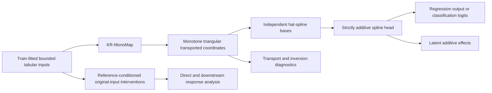

# KRAN — Knothe-Rosenblatt Additive Network for Interpretable Tabular Learning

**Research code and reproducibility materials for the revised manuscript**  
*KRAN: The Knothe-Rosenblatt Additive Network for Interpretable Tabular Learning* — Mücahit Cihan, Konya Technical University.

> **Reproducibility disclosure:** This package was updated against the revised manuscript, not against an archive of its original training runs. It contains the KRAN source code, newly implemented reproduction tools, **verbatim CSV transcriptions of 22 manuscript tables and copies of 16 embedded manuscript figures**, and the old repository's results in a labeled archive. The uploaded files did **not** contain the run-level records, experiment checkpoints, original feature-order permutations, or all original analysis scripts for the revised results. Accordingly, reference tables are **reported results**, not outputs demonstrated by the supplied code. Re-running an experiment can yield different values; it must not be presented as verification of the paper until protocols and outputs have been checked.

## Architecture



For each feature, KR-MonoMap uses a **normalized integral of a positive conditional score**, approximated with trapezoidal quadrature, to learn a coordinate-wise monotone lower-triangular transformation. A **strictly additive spline head** produces predictions from the transformed coordinates. Additive decomposition is **exact in transformed coordinates**; it is **not** independent additivity in raw input features. An original input may affect its own transformed coordinate and downstream coordinates. Original-input responses are model-based associations, **not causal effects**.

The reference model uses two width-64 SiLU hidden layers per conditional network, softplus positive integrands, `G=32` quadrature nodes, 16 hat-spline knots in the fixed-budget setting, no transport dropout, and two-logit softmax for binary classification. The repeated nested-holdout setting selects 16 or 32 knots. Main controlled runs use **no explicit covariance/HSIC/spline-smoothness penalties** (AdamW weight decay remains enabled).

## At a glance: revised paper results

**Five matched outer splits, 10 model families, six datasets (Table 4 and Table 5).** Values below are rounded descriptive means stated in the manuscript, **not independently reproduced here**.

| Dataset | Task | KRAN metric | Revised-paper value |
|---|---|---|---:|
| California Housing | Regression | R² | **0.851** |
| Energy Efficiency | Multi-output regression | R² | **0.995** |
| YearPredictionMSD (first 50k rows) | Regression | R² | **0.336** |
| Adult Income | Binary classification | Accuracy / macro-F1 | **0.878 / 0.819** |
| Breast Cancer | Binary classification | Accuracy / macro-F1 | **0.980 / 0.978** |
| Covertype (50k fixed sample) | Seven-class classification | Accuracy / macro-F1 | **0.851 / 0.777** |

KRAN achieved competitive predictive performance with measurable extra computation, **not** uniform superiority. On Covertype, RandomForest obtained the highest accuracy and LightGBM the highest macro-F1 in the reported repeated evaluation. Accuracy-only users may prefer much faster, simpler alternatives. The prose-level results above intentionally avoid ambiguous source-table strings that require a manuscript correction; see [source-data caveats](docs/MANUSCRIPT_REPOSITORY_AUDIT_TR.md).

## Install

Recommended for closely matching the reported CUDA-based KRAN environment: **Python 3.10, PyTorch 2.5.1, CUDA 12.1, FP32**; recorded hardware was an **NVIDIA RTX 4000 Ada Generation**. A compatible PyTorch CUDA wheel must be installed for the host GPU and driver. CPU-only operation is supported but timings are not directly comparable to the manuscript.

```bash
python -m venv .venv
# Linux/macOS: source .venv/bin/activate
# Windows PowerShell: .venv\Scripts\Activate.ps1
python -m pip install --upgrade pip
python -m pip install -e ".[experiments,test]"
```

All benchmark datasets require external access for first download through scikit-learn/OpenML. For extracting the manuscript's tables yourself (requires a local manuscript DOCX), use the optional package extra `.[tables]`. Neither original datasets nor the manuscript DOCX is redistributed here.

**Note:** `requirements.txt` pins PyTorch for the reported code family, but the exact GPU wheel/CUDA runtime requires a host-specific installation. Version and device details must be logged for new runs.

## Quick start: prediction

```python
import torch
from kran import KRAN, KRANConfig

model = KRAN(KRANConfig(
    input_dim=8, output_dim=1, task="regression",
    mono_integrand="softplus", mono_num_quad_points=32,
    spline_num_knots=16, head_type="additive",
))
x_scaled = torch.rand(4, 8)   # fitted train-only scaler; domain [0,1]
y_pred, extras = model(x_scaled, return_extras=True)
print(y_pred.shape)          # [4,1]
print(extras["z"].shape)    # [4,8]
```

## Reproduce the protocol, without mixing results

Execute commands from the repository root. The **new repeated-holdout script** implements outer seeds 1042–1046, train-only encoding/scaling, 80/20 outer and 80/20 inner splits, inner-validation epoch selection, selection of 16/32 KRAN knots, regression target standardization using inner/outer training statistics, full outer refits, and the ten model families. It writes fresh measurements into `results/generated/` and saves KRAN checkpoints for follow-on analyses.

```bash
# Full 300-cell repeated experiment; substantial compute and data downloads
python -m experiments.run_repeated_holdout

# Check presence and internal consistency of the resulting records
python scripts/audit_generated_runs.py results/generated/repeated_holdout/run_level.csv

# Short functional demonstration; intentionally NOT a manuscript reproduction
python -m experiments.run_repeated_holdout --datasets breast_cancer --models KRAN,MLP --seeds 1042 --max-epochs 2 --output results/generated/smoke
```

**Do not copy new benchmark numbers into the paper without checking both numerical agreement and selection/data provenance.** The original per-seed checkpoints and some algorithm-specific configuration details are absent from the initial upload. See [REPRODUCIBILITY.md](docs/REPRODUCIBILITY.md) for exact-match caveats and run-by-run verification steps.

### Additional analyses

```bash
# Existing fixed-budget scripts: distinct from the nested-holdout main comparison
python -m experiments.run_main_benchmarks
python -m experiments.run_ablation
python -m experiments.run_five_seed_ablation
python -m experiments.run_quadrature_diagnostics
python -m experiments.run_regularization
python -m experiments.run_normalization
python -m experiments.run_noise_robustness
python -m experiments.run_feature_ordering
python -m experiments.run_interpretability_stability

# Original-feature analyses (require new saved repeated-holdout checkpoints)
python -m experiments.run_original_feature_responses
python -m experiments.run_original_feature_attributions --seed 1042 --steps 1024
python -m experiments.run_fixed_weight_quadrature --dataset breast_cancer --seed 1042

# Matched feature-order control: 5 splits x 2 restarts x 4 orders
python -m experiments.run_controlled_ordering
python -m experiments.run_ordered_explanations

# Separate Python process per synthetic dimension and quadrature grid
python -m experiments.run_scalability
```

The IG routine reports completeness residuals; SHAP is optional and computationally expensive (`--shap`). For original-feature responses, the class-0-minus-class-1 log-odds response in Breast Cancer corresponds to **malignant versus benign**. Descriptive response bands across reference profiles are **not confidence intervals**. All original-input response and sensitivity scripts **need real checkpoints produced by an appropriate training run**, which were not in the supplied ZIP.

**Coverage matters:** The available original script for `run_interpretability_stability` reports model-internal ranking stability but does not recreate every IG, grouped permutation, SHAP, spline-profile, or Adult Income perturbation result in Sections 5.9–5.10. The implemented new analysis scripts are documented as reproduction tools, not a claim of exact published result regeneration. A complete coverage audit is included below.

## Files and provenance

```text
KRAN/
├── kran/                               core architecture, training, metrics,
│                                       repeated evaluation and explanations
├── experiments/                        fixed-budget and newly developed repeated
│                                       and interpretation experiment entry points
├── results/
│   ├── manuscript_tables/              22 CSVs transcribed from the supplied DOCX
│   ├── legacy_initial_repository/      untouched CSVs from the original ZIP
│   └── generated/                      newly executed outputs; git-ignored
├── figures/manuscript/                 16 extracted manuscript images (not replotted)
├── scripts/                             table/figure extraction + run auditor
├── docs/                                experiment matrix and audit disclosures
├── tests/                               structural, numerical and protocol tests
├── .github/workflows/tests.yml          automated tests
├── CITATION.cff
└── pyproject.toml
```

- [`docs/REPRODUCIBILITY.md`](docs/REPRODUCIBILITY.md): protocol, versions, seeds, limitations and validation.
- [`docs/EXPERIMENT_MATRIX.md`](docs/EXPERIMENT_MATRIX.md): source tables, experiments and reproduction status.
- [`docs/MANUSCRIPT_REPOSITORY_AUDIT_TR.md`](docs/MANUSCRIPT_REPOSITORY_AUDIT_TR.md): Turkish audit of the original ZIP against the revised DOCX, including manuscript issues affecting public GitHub claims.
- [`results/README.md`](results/README.md): strict distinction between source-table values, legacy results and generated runs.

## Testing

```bash
python -m pytest -q
```

The tested invariants include tensor/boundedness checks, exact additive-head decomposition, coordinate monotonicity on sampled points, class-log-odds original-feature direct/downstream decomposition, Integrated Gradients completeness for a linear reference model, train-only scaling, split disjointness and benchmark model parameter count. These tests do **not** certify that unprovided raw experimental results are fully reproducible.

## Citation and license status

Refer to `CITATION.cff`; do not invent a publication DOI or journal issue before one is available. **The original repository did not contain a LICENSE file.** No license has been invented for this update; the repository owner should explicitly select and add a license before making reuse permissions public.
