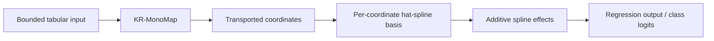

# KRAN: The Knothe-Rosenblatt Additive Network for Interpretable Tabular Learning

Official implementation of **KRAN: The Knothe-Rosenblatt Additive Network for Interpretable Tabular Learning**.



## Overview

KRAN is a supervised **transport-then-additive** neural architecture for interpretable tabular learning. Bounded input features are mapped through a Knothe-Rosenblatt-inspired monotone triangular transformation (**KR-MonoMap**). Each transported coordinate is then expanded with local hat-spline basis functions and evaluated by a **strictly additive spline prediction head**.

The implementation supports regression and classification together with numerical, robustness, regularization, interpretability-stability, and scalability analyses.

## Core design

1. **Leakage-free preprocessing** — the dataset is split before preprocessing, and fitted transformations are learned only from the training partition.
2. **Normalized KR-MonoMap** — each transported coordinate is defined by a normalized integral of a strictly positive conditional score.
3. **Local hat-spline expansion** — transported coordinates are expanded independently using local-support spline basis functions.
4. **Strictly additive prediction** — regression outputs or classification logits are sums of feature-wise spline effects.
5. **Structured diagnostics** — the repository includes monotonicity, approximate inversion, calibration, feature-importance, stability, robustness, and scalability analyses.

## Repository structure

```text
KRAN/
├── kran/                       # model components and utilities
├── experiments/                # benchmark and analysis scripts
├── results/                    # generated experiment outputs
├── tests/                      # structural and numerical tests
├── .github/workflows/          # automated test workflow
├── requirements.txt
├── pyproject.toml
└── CITATION.cff
```

## Installation

The experimental environment uses Python 3.10, NumPy 1.26, PyTorch 2.5, and CUDA 12.1.

```bash
python -m venv .venv
source .venv/bin/activate       # Windows: .venv\Scripts\activate
pip install --upgrade pip
pip install -r requirements.txt
pip install -e .
```

CUDA 12.1 describes the experimental runtime. Install the PyTorch build appropriate for your system if the default wheel is not suitable.

## Quick model example

```python
import torch
from kran import KRAN, KRANConfig

model = KRAN(KRANConfig(
    input_dim=8,
    output_dim=1,
    task="regression",
    mono_integrand="softplus",
    mono_num_quad_points=32,
    spline_num_knots=16,
))

x = torch.rand(32, 8)  # features must be scaled to [0, 1]
y_hat = model(x)
```

## Datasets

Experiments use six public tabular benchmarks fetched through scikit-learn and OpenML.

| Dataset | Task | Main setting |
|---|---|---|
| Breast Cancer | Binary classification | 80/20 split, batch 32, 50 epochs |
| Covertype | 7-class classification | 50k subset, batch 256, 10 epochs |
| Adult Income | Binary classification | one-hot encoded, batch 256, 10 epochs |
| Energy Efficiency | Multi-output regression | batch 32, 100 epochs |
| California Housing | Regression | batch 256, 30 epochs |
| YearPredictionMSD | Regression | 50k subset, batch 256, 20 epochs |

All preprocessing transformations are fitted **only on the training split** and then applied unchanged to the test split.

## Running the experiments

Run scripts from the repository root. Public datasets are downloaded automatically on first use.

```bash
python experiments/run_main_benchmarks.py
python experiments/run_ablation.py
python experiments/run_quadrature_diagnostics.py
python experiments/run_regularization.py
python experiments/run_normalization.py
python experiments/run_noise_robustness.py
python experiments/run_feature_ordering.py
python experiments/run_interpretability_stability.py
python experiments/run_scalability.py
```

Generated CSV outputs are written to `results/`.

## Default KRAN configuration

The main configuration uses:

- SiLU activation
- softplus positive integrand
- 32 quadrature points
- 16 spline knots
- no KR-MonoMap dropout
- strictly additive spline prediction head
- AdamW optimization
- gradient clipping with maximum norm 5.0
- FP32 precision

## Selected benchmark results

In the reported evaluation, KRAN obtained R² values of **0.852** on California Housing, **0.998** on Energy Efficiency, and **0.334** on YearPredictionMSD. Classification accuracy / macro-F1 was **0.877 / 0.818** on Adult Income, **0.983 / 0.981** on Breast Cancer, and **0.794 / 0.717** on Covertype.

The complete experimental evaluation is reported in the accompanying article.

## Citation

A `CITATION.cff` file is included. Bibliographic metadata will be updated when the final publication information is available.

## Code availability

The repository contains the KRAN source code, experiment scripts, evaluation utilities, and reproducibility tests.
